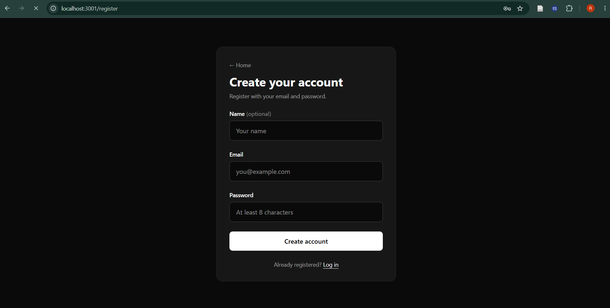
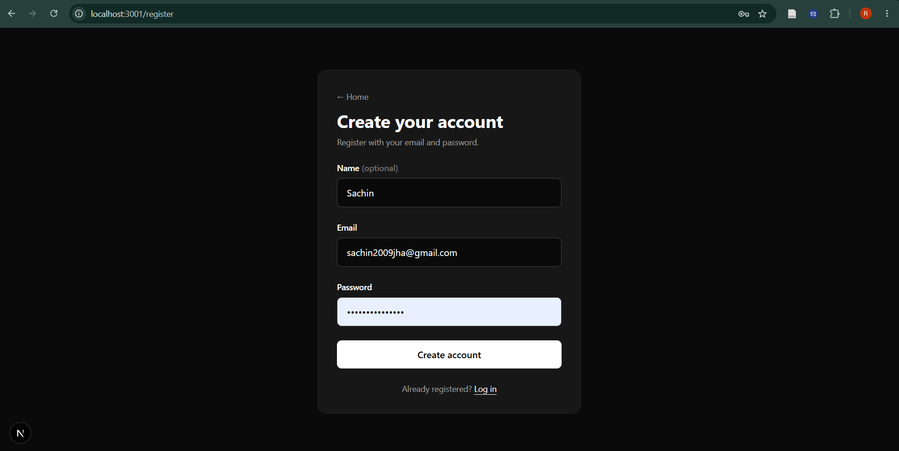
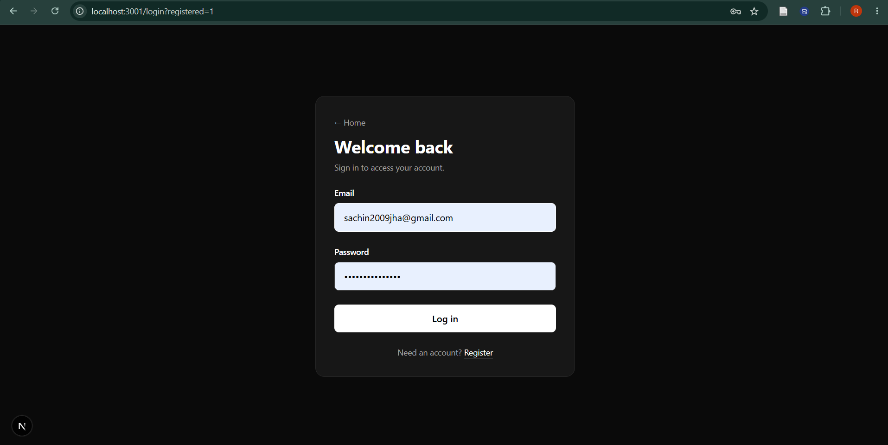
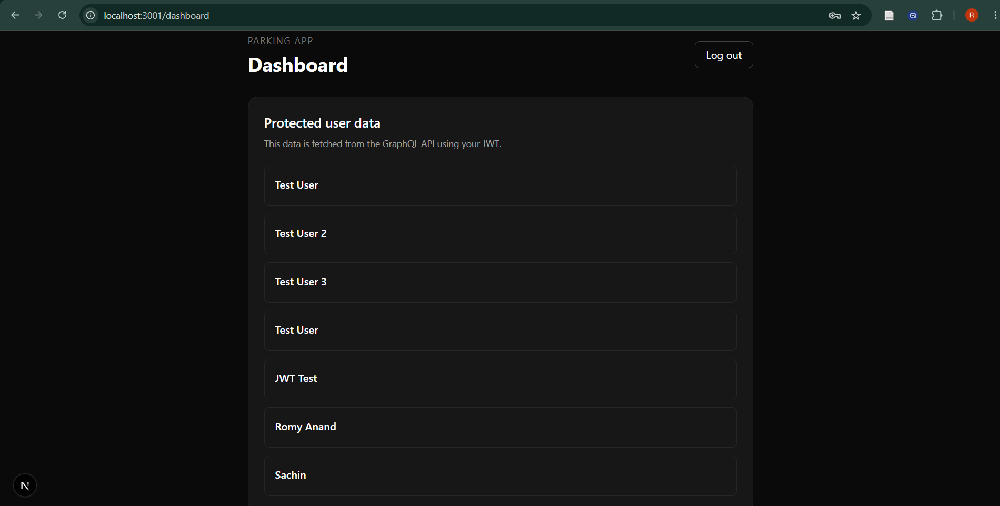

# ParkingApp

A full-stack parking management application currently implementing user authentication and authorization.

## Overview

ParkingApp is a monorepo project built with Next.js, NestJS, GraphQL, and PostgreSQL. The current implementation focuses on the authentication layer, allowing users to create accounts, log in, and access protected resources using JWT-based authentication.

## Motivation

The goal of this project is to build a parking management application while developing a deeper understanding of full-stack application architecture, API design, authentication, authorization, and database integration.

## Tech Stack

- **Frontend:** Next.js, React, TypeScript, Tailwind CSS
- **Backend:** NestJS, GraphQL, Apollo Server
- **Database:** PostgreSQL
- **ORM:** Prisma
- **Authentication:** JWT (JSON Web Tokens)
- **Package Manager:** pnpm

## Features

- User registration with credentials.
- User login with credential validation.
- JWT-based access token generation.
- Protected GraphQL queries using JWT authentication.
- Dashboard access restricted to authenticated users.
- PostgreSQL integration for user data persistence.

## Project Screenshot
### The screenshot of home page

### The register page

### The login page

### The screenshot of dashboard page after you log in

## How to Use

1. Open the application in your browser.
2. Navigate to the registration page and create an account.
3. Log in using your registered credentials.
4. After successful authentication, you'll be redirected to the dashboard.
5. The dashboard fetches user data through a JWT-protected GraphQL query.
6. Log out to end your session and return to the login page.